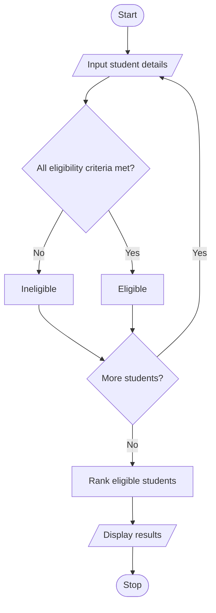

University Scholarship Allocation System Using Python 
## 1. Problem Statement
University Scholarship Allocation: Design a system that evaluates applicants using aggregate marks, subject-wise minimum scores, attendance, and income criteria, ranks eligible students, and resolves ties using predefined rules. 
 
## 2. Algorithm

1. Start the program.
2. Read the number of student applicants.
3. For each student, input the name, aggregate marks, subject-wise marks, attendance percentage, and annual family income.
4. Check whether the aggregate marks meet the minimum requirement.
5. Check whether every subject mark meets the minimum requirement.
6. Check whether attendance meets the minimum requirement.
7. Check whether annual family income is within the permitted limit.
8. If all conditions are satisfied, add the student to the eligible list. Otherwise, mark the student as ineligible.
9. Sort eligible students using the following priorities:
   - Aggregate marks in descending order.
   - Attendance in descending order.
   - Annual family income in ascending order.
   - Name in alphabetical order.
10. Display the ranked eligible students and their details.
11. Display the ineligible students and their reasons.
12. Stop the program.

## 3. Flowchart

 ## 5. Sample Input

Enter number of applicants: 4

Enter details for student 1
Name: Aarav
Aggregate marks (%): 90
Number of subjects: 2
Subject 1 marks (%): 85
Subject 2 marks (%): 95
Attendance percentage: 90
Annual family income (Rs.): 200000

Enter details for student 2
Name: Bhavya
Aggregate marks (%): 90
Number of subjects: 2
Subject 1 marks (%): 88
Subject 2 marks (%): 92
Attendance percentage: 85
Annual family income (Rs.): 180000

Enter details for student 3
Name: Charan
Aggregate marks (%): 80
Number of subjects: 2
Subject 1 marks (%): 55
Subject 2 marks (%): 85
Attendance percentage: 90
Annual family income (Rs.): 150000

Enter details for student 4
Name: Divya
Aggregate marks (%): 78
Number of subjects: 2
Subject 1 marks (%): 70
Subject 2 marks (%): 80
Attendance percentage: 80
Annual family income (Rs.): 300000

## 6. Sample Output
===== SCHOLARSHIP RANK LIST =====
1. Aarav | Aggregate: 90.00% | Attendance: 90.00% | Income: Rs. 200000.00
2. Bhavya | Aggregate: 90.00% | Attendance: 85.00% | Income: Rs. 180000.00

===== INELIGIBLE STUDENTS =====
Charan: Subject marks below 60%
Divya: Annual income exceeds Rs. 250000

 
