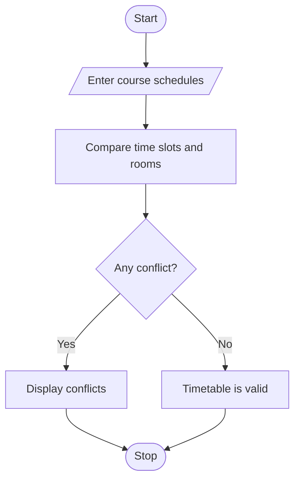

 # Student Timetable Conflict Detection

## 1. Problem Statement
  Student Timetable Conflict Detection: Compare course schedules represented by strings and tuples, detect overlapping periods, identify unavailable rooms, and validate a proposed timetable. 

## 2. Algorithm

1. Start the program.
2. Enter course details, time slots, and room numbers.
3. Store each course schedule as a tuple.
4. Compare the time slots of each pair of courses.
5. Check whether the same room is assigned to overlapping classes.
6. Display timetable conflicts or confirm that the timetable is valid.
7. Stop the program.

## 3. Flowchart

  

## 5. Sample Input
Python  09:00-10:00  R1
Java    09:30-10:30  R2
Maths   10:00-11:00  R1

## 6. Sample Output
Python and Java : Time conflict
Java and Maths : Time conflict

 
