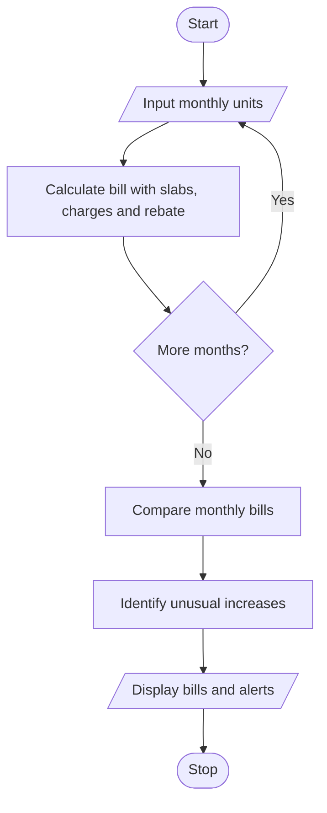

# Progressive Electricity Billing System Using Python

## 1. Problem Statement
 Progressive Electricity Billing: Calculate household bills using multiple consumption slabs, fixed charges, surcharges, and rebates, then compare bills across several months and identify unusual increases. 
 
## 2. Algorithm

1. Start the program.
2. Input the number of months and each month's electricity consumption.
3. Calculate energy charges using progressive slabs.
4. Add fixed charges and a 5% surcharge.
5. Apply the rebate when consumption is at most 100 units.
6. Calculate the final bill for each month.
7. Compare each month's bill with the previous month's bill.
8. If the increase exceeds 20%, mark it as unusual.
9. Display monthly consumption, bills, and unusual increases.
10. Stop.

## 3. Flowchart 

 

## 5. Sample Input
Enter number of months: 3
Units for month 1: 80
Units for month 2: 150
Units for month 3: 250

## 6. Sample Output
Month 1 Bill: Rs.202.00
Month 2 Bill: Rs.417.50
Month 3 Bill: Rs.837.50

Bill Comparison:
Month 2: Unusual increase (106.68%)
Month 3: Unusual increase (100.60%)

 
