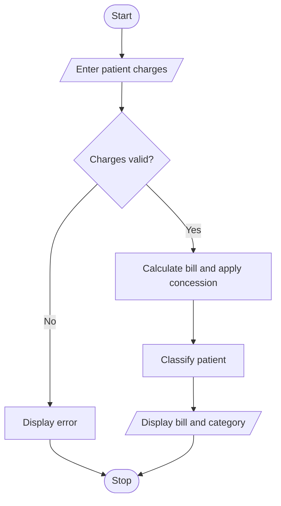

# Hospital Billing and Patient Classification Using Python

## 1. Problem Statement

 Hospital Billing and Patient Classification: Process consultation, diagnostic, and treatment charges, apply conditional concessions, validate billing constraints, and classify patients according to a supplied payment policy. 

## 2. Algorithm

1. Start.
2. Input patient name and consultation, diagnostic, and treatment charges.
3. Validate that all charges are non-negative.
4. Calculate the total bill.
5. If the total is at least ₹5,000, apply a 10% concession.
6. Calculate the final payable amount.
7. Classify the patient based on the final bill.
8. Display the total bill, concession, final amount, and classification.
9. Stop.

## 3. Flowchart 

 
## 5. Sample Input
Patient name: Ravi
Consultation charge: 1000
Diagnostic charge: 2500
Treatment charge: 3000

## 6. Sample Output
--- Hospital Bill ---
Patient: Ravi
Total Bill: Rs. 6500.0
Concession: Rs. 650.0
Final Bill: Rs. 5850.0
Classification: Medium Bill

 

 
