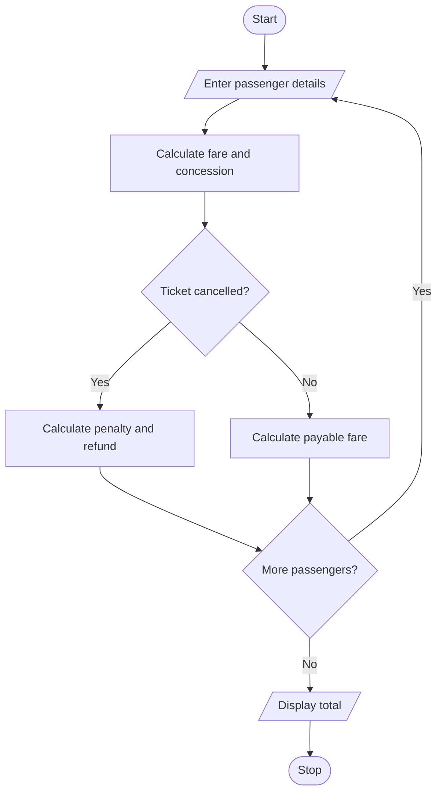

# Railway Fare and Reservation Calculator Using Python

## 1. Problem Statement
Railway Fare and Reservation Calculator: Calculate fares for multiple passengers using distance slabs, travel classes, age-based concessions, reservation fees, and specified cancellation penalties. 
 
## 2. Algorithm

1. Start the program.
2. Input the number of passengers.
3. For each passenger, enter name, age, distance, travel class, and cancellation status.
4. Calculate the base fare using distance slabs.
5. Apply the travel class multiplier.
6. Apply the age concession if eligible.
7. Add the reservation fee.
8. If cancelled, deduct the specified cancellation penalty.
9. Display each passenger's fare and the total amount for all passengers.
10. Stop.

## 3. Flowchart 

 
## 5. Sample Input
Number of passengers: 2

Passenger 1
Name: Ravi
Age: 30
Distance (km): 200
Class (Sleeper/AC): Sleeper
Cancel ticket? (yes/no): no

Passenger 2
Name: Sita
Age: 65
Distance (km): 200
Class (Sleeper/AC): AC
Cancel ticket? (yes/no): yes

## 6. Sample Output
Passenger 1
Ticket fare: Rs. 310.0

Passenger 2
Cancellation penalty: Rs. 270.0
Refund amount: Rs. 850.0

Total fare for active bookings: Rs. 310.0

 
