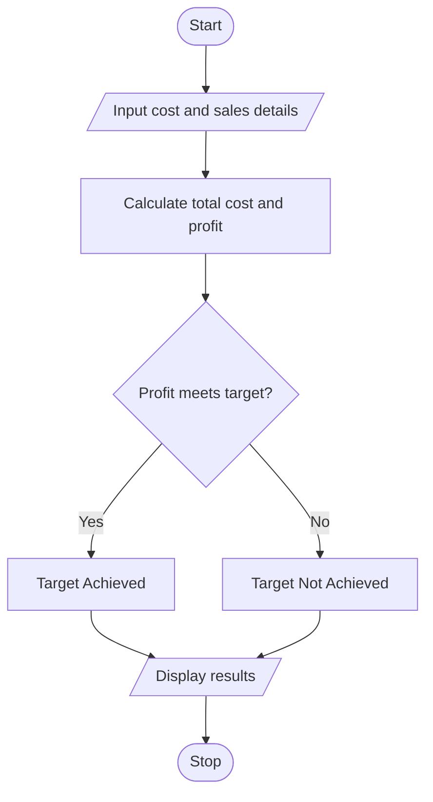

 # Manufacturing Cost and Profitability Analysis Using Python

## 1. Problem Statement
 Manufacturing Cost and Profitability Analysis: Calculate material costs, labour charges, wastage, machine costs, and selling prices; identify whether production meets a specified profit target. 
 

## 2. Algorithm

1. Start.
2. Input material cost, labour cost, machine cost, wastage percentage, quantity produced, selling price per unit, and profit target.
3. Calculate wastage cost.
4. Calculate total production cost.
5. Calculate total selling revenue.
6. Calculate profit.
7. Compare profit with the target.
8. Display total cost, revenue, profit, and target status.
9. Stop.

## 3. Flowchart

 

## 5. Sample Input
Material cost: 10000
Labour cost: 5000
Machine cost: 3000
Wastage percentage: 10
Quantity produced: 100
Selling price per unit: 250
Profit target: 5000

## 6. Sample Output

Total Cost: 19000.0
Revenue: 25000
Profit: 6000.0
Status: Target Achieved

 
