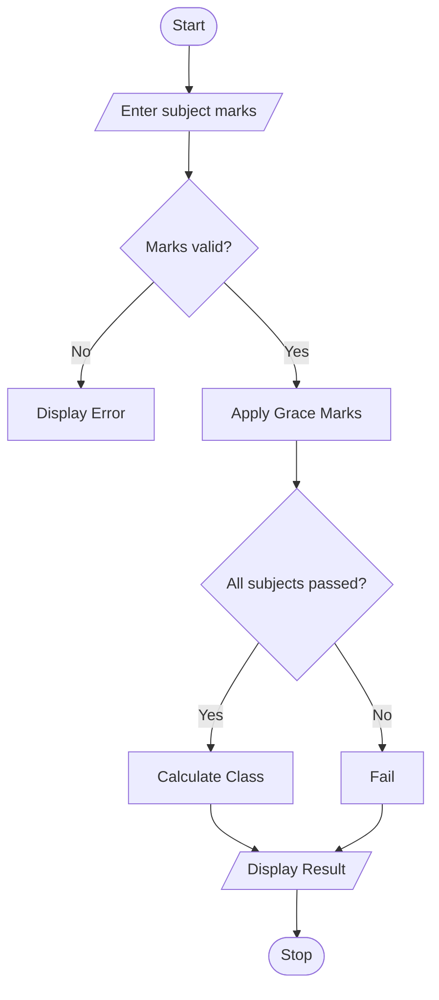

# Examination Result and Grace-Mark Validation Using Python

## 1. Problem Statement
 Examination Result and Grace-Mark Validation: Process marks across multiple subjects, apply subject-wise pass criteria and a specified grace-mark policy, and generate final classifications without exceeding maximum marks. 
 

## 2. Algorithm

1. Start.
2. Input the number of subjects and marks obtained in each subject.
3. Validate that each mark is between 0 and 100.
4. Check whether each subject meets the passing mark of 35.
5. If a subject is short by at most 5 marks, apply the required grace marks.
6. Ensure the final marks do not exceed 100.
7. Check whether all subjects are passed.
8. Calculate the overall percentage and determine the classification.
9. Display final subject marks, percentage, and result.
10. Stop.

## 3. Flowchart

  

## 5. Sample Input
Number of subjects: 4
Marks in subject 1: 80
Marks in subject 2: 32
Marks in subject 3: 65
Marks in subject 4: 70

## 6. Sample Output

Final Marks: [80, 35, 65, 70]
Percentage: 62.5 %
Result: First Class

 

The program validates subject marks, applies grace marks to eligible subjects, ensures marks remain within the maximum limit, and generates the student's final result and classification.
