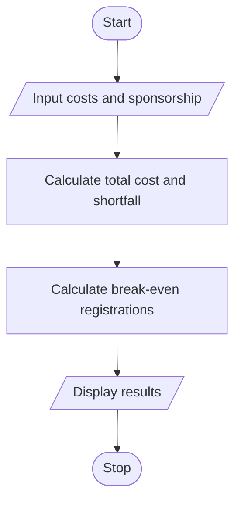

# Campus Event Financial Planning Using Python

## 1. Problem Statement

The Campus Event Financial Planning System calculates the total cost of organizing a campus event, including venue, equipment, catering, transport, and certificates. It determines the participant contribution, calculates any sponsorship shortfall, and finds the minimum number of registrations required to break even.

 

## 2. Algorithm

1. Start.
2. Input all event expenses and available sponsorship.
3. Calculate total event cost.
4. Input the contribution per participant.
5. Calculate the sponsorship shortfall after expected registrations.
6. Calculate the minimum registrations required to break even.
7. Display total cost, participant contributions, sponsorship shortfall, and break-even count.
8. Stop.

## 3. Flowchart 

 
 

## 5. Sample Input
Venue cost: 10000
Equipment cost: 5000
Catering cost: 15000
Transport cost: 4000
Certificate cost: 1000
Sponsorship amount: 10000
Expected participants: 40
Contribution per participant: 500

## 6. Sample Output
Total Event Cost: 35000.0
Participant Contributions: 20000.0
Sponsorship Shortfall: 5000.0
Break-even Registrations: 50

 
