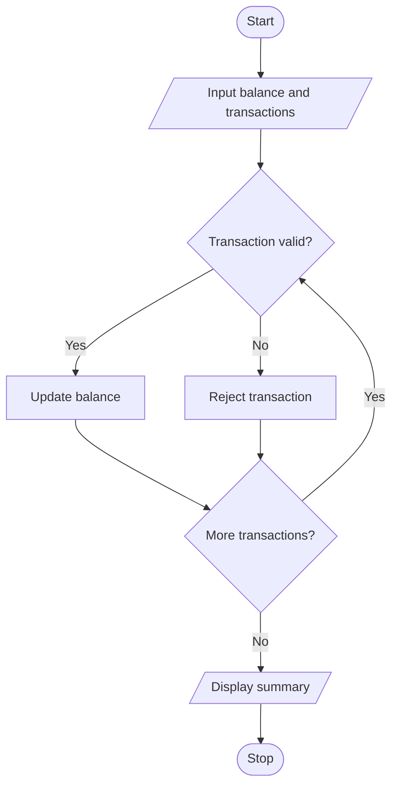

# ATM Transaction Sequence Simulation Using Python

## 1. Problem Statement

The ATM Transaction Sequence Simulation processes deposits and withdrawals while maintaining a simulated account balance. It enforces a maximum withdrawal limit, rejects invalid transactions, prevents withdrawals exceeding the available balance, and displays a summary of successful and rejected transactions.

 
## 2. Algorithm

1. Start.
2. Input the initial account balance and number of transactions.
3. For each transaction, input the type and amount.
4. If the transaction is a valid deposit, add the amount to the balance.
5. If it is a valid withdrawal within the limit and available balance, subtract the amount.
6. Reject invalid transactions.
7. Count successful and rejected transactions.
8. Display the final balance and transaction summary.
9. Stop.

## 3. Flowchart 

 

## 5. Sample Input

Initial balance: 5000
Number of transactions: 3
Transaction (deposit/withdraw): deposit
Amount: 2000
Transaction (deposit/withdraw): withdraw
Amount: 3000
Transaction (deposit/withdraw): withdraw
Amount: 12000

## 6. Sample Output

Transaction rejected

Final Balance: 4000.0
Successful Transactions: 2
Rejected Transactions: 1

 
