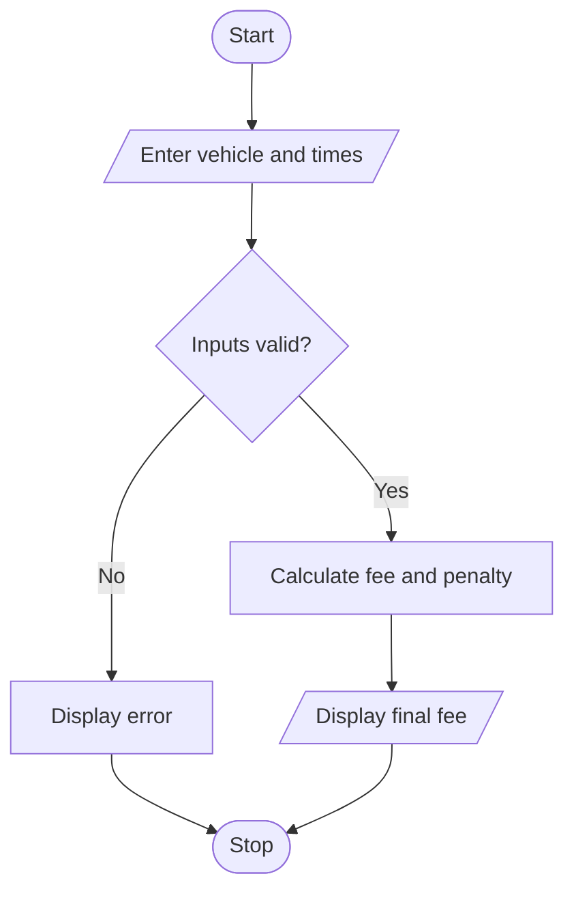

# Smart Parking Fee Management Using Python

## 1. Problem Statement

The Smart Parking Fee Management System calculates parking charges based on vehicle category, entry time, exit time, overnight parking, and daily fee limits. It validates time inputs and applies a penalty when the vehicle remains parked for more than 24 hours.

 
## 2. Algorithm

1. Start.
2. Input vehicle category, entry time, and exit time.
3. Validate the time format and vehicle category.
4. Calculate the parking duration.
5. Calculate the fee based on vehicle category and hours parked.
6. Apply the daily limit, overnight charge, and penalty if applicable.
7. Display parking duration and final fee.
8. Stop.

## 3. Flowchart 

  

## 5. Sample Input
Vehicle (bike/car): car
Entry time (HH:MM): 21:00
Exit time (HH:MM): 23:30

## 6. Sample Output
Parking hours: 3
Overnight charge: 50
Final parking fee: Rs. 170

 
